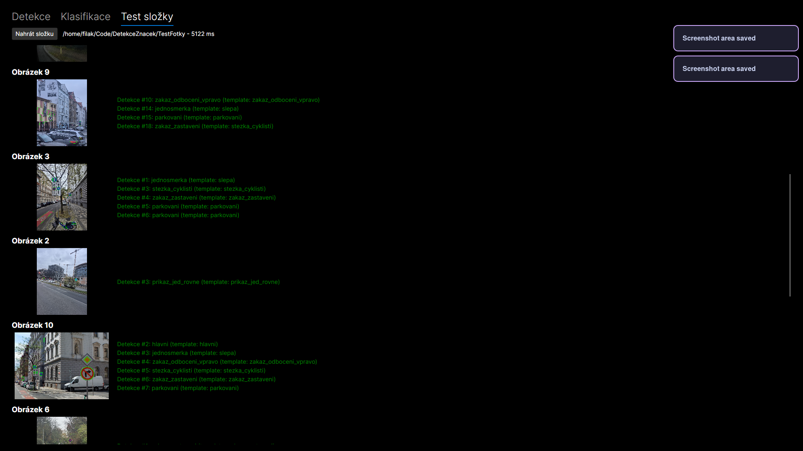

# DetekceZnacek

[](LICENSE)
[](https://dotnet.microsoft.com/)
[](https://avaloniaui.net/)


**Detekce a rozpoznávání dopravních značek** pomocí:
- Template matching s metodou RMSE/ZNCC
- Histogram orientovaných gradientů s k-NN




## Tutoriál

### 1. Stáhnutí aplikace
Z [GitHub Releases](https://github.com/Filakcz/DetekceZnacek/releases) se dá stáhnout nejnovější zkompilovaná aplikace/binárka (Windows, Linux, MacOS) a zazipovaná složka `Vzory.zip` + `TestFotky.zip`.

Na Linuxu se musí použít `chmod +x DetekceZnacek` a potom `./DetekceZnacek`. 

### 2. Spuštění aplikace
Ve stejné složce jako aplikace musí být složka `Vzory`, které obsahuje vzory dopravních značek. **Bez složky se aplikace nespustí!**

### 3. Jeden obrázek
Stačí nahrát obrázek (`.png`, `.jpg`, `.jpeg`, `.bmp`) v tabu `Detekce`. Sliderem jde vidět barvy v masce a finální obrysy. Klasifikace tohoto obrázku je v dalším tabu `Klasifikace`.

### 4. Složka s řešením
V tabu `Test složky` jde nahrát složka, která musí obsahovat soubor `Reseni.txt` a obrázky, které mají stejný název jako v řešení. Zpracování složky trvá několik sekund. Názorná složka je `TestFotky.zip`. Syntax řešení je následovně (+příklad):

```
nazev_obrazku=znacka1;znacka2;znacka3

5=hlavni;prechod_chodci;zakaz_odboceni_vlevo
```

### Jak udělat binárku
Je potřeba být (`cd`) ve složce `AvaloniaDetekceZnacek`, když se davá `dotnet run` nebo tvoří binárka. Potřebné parametry (jako `PublishSingleFile`) jsou už v `.csproj`.

**Windows:**
```
dotnet publish -r win-x64 -c Release
```
**Linux:**
```
dotnet publish -r linux-x64 -c Release
```

**MacOS:**
```
dotnet publish -r osx-x64 -c Release
```

## License
This project is licensed under the [Apache License 2.0](LICENSE).
